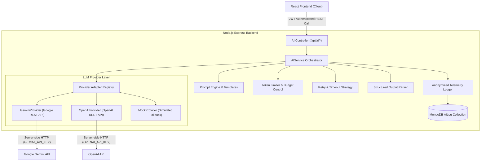

# StudyGauge AI Subsystem Architecture

## 1. Executive Summary & Core Rationale

StudyGauge is an adaptive competitive-exam preparation platform following the pedagogical loop:
$$\text{TRACK} \longrightarrow \text{ANALYZE} \longrightarrow \text{IDENTIFY WEAKNESS} \longrightarrow \text{RECOMMEND} \longrightarrow \text{ADAPT} \longrightarrow \text{IMPROVE}$$

### Why NOT a Generic Chatbot?
Generic LLM chatbots suffer from hallucination, lack of pedagogical guardrails, context sprawl, and unpredictable responses. In StudyGauge:
- Core analytics, readiness scores, and priority calculations remain 100% deterministic (handled by backend algorithms).
- The **AI Subsystem** is used strictly for high-value cognitive tasks:
  1. **Weak Topic Explanations:** Step-by-step breakdown tailored to student error history.
  2. **Structured Quiz Question Generation:** High-yield multiple-choice questions with detailed option explanations.
  3. **Personalized Study Guidance:** Pedagogical advice based on schedule gap analysis and weakness severity.
  4. **High-Yield Revision Summaries:** Quick flashcard bullet points and trap question alerts.
  5. **RAG-based Contextual Study Assistance:** Answering user study queries using verified study context chunks.

---

## 2. High-Level System Architecture

The AI layer is designed using a **Pluggable Adapter Pattern**, completely decoupling business logic and API controllers from underlying LLM vendors.



---

## 3. Key Architectural Requirements & Implementation

### 3.1 LLM Service Abstraction (Provider Independence)
- **Abstract Contract (`BaseProvider`):** Establishes common method signatures (`generateText`, `generateStructured`, `isAvailable`).
- **Replaceable Provider Adapters:**
  - `GeminiProvider`: Connects to Google Gemini REST API using server-side environment variables (`GEMINI_API_KEY`).
  - `OpenAIProvider`: Connects to OpenAI Chat Completions REST API (`OPENAI_API_KEY`).
  - `MockProvider`: Local, deterministic provider for offline development, integration testing, and automatic system fallback.
- **Provider Switching:** Configured via `AI_PROVIDER` environment variable (`gemini`, `openai`, or `mock`).

### 3.2 Secure Server-Side API Calls
- **Zero Client Key Exposure:** All AI credentials (`GEMINI_API_KEY`, `OPENAI_API_KEY`) remain strictly on the Node.js server.
- **React Frontend Isolation:** The React frontend interacts only with protected backend Express endpoints (`/api/ai/...`) via JWT headers.

### 3.3 Prompt Templates & Guardrails
- **Centralized Registry (`promptTemplates.js` & `promptEngine.js`):** Defines strict system directives (`SYSTEM_DIRECTIVE`) and domain templates (`CONCEPT_EXPLANATION`, `QUESTION_GENERATION`, `STUDY_GUIDANCE`, `REVISION_SUMMARY`, `RAG_QUERY`, `GENERAL_STUDY_HELP`).
- **Prompt Injection Defense:** Variable inputs are sanitized (`sanitizeVariable()`) to strip instruction overrides (e.g. `<system>`, `[SYSTEM_INSTRUCTION]`).
- **Pedagogical Rules:** Strictly enforces academic tone, forbids off-topic conversation, and requires valid output structures.

### 3.4 Token Limits & Context Budget Control
- **Task-Based Token Budgets (`tokenLimiter.js`):**
  - `CONCEPT_EXPLANATION`: 3,000 input tokens / 1,000 output tokens.
  - `QUESTION_GENERATION`: 2,500 input tokens / 1,200 output tokens.
  - `STUDY_GUIDANCE`: 3,500 input tokens / 1,000 output tokens.
  - `REVISION_SUMMARY`: 4,000 input tokens / 800 output tokens.
  - `RAG_QUERY`: 4,500 input tokens / 1,000 output tokens.
- **Absolute Safety Cap:** Hard cap at 8,000 input tokens (`ABSOLUTE_MAX_INPUT_TOKENS`). Exceeding this cap throws an `AITokenLimitExceededError`.
- **Context Pruner (`pruneTextToTokenLimit`):** Truncates long background context cleanly before calling LLM providers.

### 3.5 Error Handling, Timeout & Exponential Backoff Retries
- **Custom AI Error Hierarchy (`AIError.js`):**
  - `AITimeoutError` (HTTP 504)
  - `AIRateLimitError` (HTTP 429)
  - `AIProviderError` (HTTP 502)
  - `AIValidationError` (HTTP 422)
  - `AITokenLimitExceededError` (HTTP 400)
- **Timeout Protection (`withTimeout`):** Uses `AbortController` and `Promise.race` with a configurable timeout (default 15,000ms).
- **Exponential Backoff (`executeWithRetry`):** Retries transient errors (HTTP 429, 500, 502, 503, 504, `ETIMEDOUT`) with jitter to prevent thundering herd problems (default max 3 retries).
- **Automatic Mock Fallback:** If the primary AI provider fails after retries, `AIService` automatically fails over to `MockProvider`, ensuring 100% service availability for students.

### 3.6 Anonymized Telemetry & Usage Logging (Privacy & Security)
- **Database Schema (`AILog`):** Stores operational metadata (`userId`, `provider`, `model`, `taskType`, `promptTokens`, `completionTokens`, `totalTokens`, `latencyMs`, `status`, `costEstimate`, `isFallbackUsed`).
- **PRIVACY MANDATE:** User prompt text, question context, and completion response strings are **NEVER** stored in telemetry database logs.

### 3.7 Structured Output Support
- **Output Cleaning (`structuredOutputParser.js`):** Strips Markdown triple backticks (` ```json ... ``` `) and trailing text.
- **Validation:** Validates parsed JSON against required top-level fields and custom schema validation functions, throwing `AIValidationError` if invalid.

---

## 4. File Structure

```
server/
├── src/
│   ├── models/
│   │   └── AILog.js                       # Anonymized telemetry schema (NO sensitive text)
│   ├── services/
│   │   └── ai/
│   │       ├── AIService.js               # Core AI Orchestrator Service
│   │       ├── aiLogger.js                # Anonymized telemetry logger & cost estimator
│   │       ├── errors/
│   │       │   └── AIError.js             # Custom AI Error hierarchy
│   │       ├── providers/
│   │       │   ├── BaseProvider.js        # Abstract provider interface
│   │       │   ├── GeminiProvider.js      # Google Gemini REST adapter
│   │       │   ├── OpenAIProvider.js      # OpenAI REST adapter
│   │       │   └── MockProvider.js        # Offline & fallback mock provider
│   │       ├── prompts/
│   │       │   ├── promptTemplates.js     # Domain-specific prompt templates
│   │       │   └── promptEngine.js        # Variable substitution & sanitization
│   │       └── utils/
│   │           ├── tokenLimiter.js        # Token estimation & context pruner
│   │           ├── retryStrategy.js       # Exponential backoff & timeout handling
│   │           └── structuredOutputParser.js # Markdown stripper & JSON validator
│   ├── controllers/
│   │   └── aiController.js                # HTTP controller for Express routes
│   ├── routes/
│   │   └── aiRoutes.js                    # Protected Express router (/api/ai/*)
│   └── validations/
│       └── aiValidation.js                # Joi validation schemas
└── tests/
    └── aiSubsystem.test.js                # Comprehensive Jest integration test suite
```

---

## 5. API Reference

All routes require JWT Authorization header: `Authorization: Bearer <token>`.

### 1. `POST /api/ai/explain`
Generates personalized concept explanation for a weak topic.
- **Request Body:**
  ```json
  {
    "topicName": "Rotational Motion",
    "subjectName": "Physics",
    "examName": "JEE Advanced",
    "weaknessLevel": "WEAK",
    "accuracy": 25
  }
  ```
- **Response:**
  ```json
  {
    "success": true,
    "data": {
      "explanation": "Markdown concept explanation string...",
      "metadata": {
        "provider": "gemini",
        "model": "gemini-1.5-flash",
        "totalTokens": 450,
        "latencyMs": 1200,
        "isFallbackUsed": false
      }
    }
  }
  ```

### 2. `POST /api/ai/questions`
Generates structured practice quiz questions.
- **Request Body:**
  ```json
  {
    "topicName": "Thermodynamics",
    "subjectName": "Physics",
    "examName": "NEET",
    "count": 2,
    "difficulty": "Medium"
  }
  ```
- **Response:**
  ```json
  {
    "success": true,
    "data": {
      "questions": [
        {
          "questionId": "q1",
          "questionText": "Question statement...",
          "options": ["Opt A", "Opt B", "Opt C", "Opt D"],
          "correctAnswerIndex": 0,
          "explanation": "Detailed explanation..."
        }
      ],
      "topic": "Thermodynamics",
      "subject": "Physics",
      "metadata": { ... }
    }
  }
  ```

### 3. `POST /api/ai/study-advice`
Generates personalized, actionable study advice based on gap detection & analytics.
- **Request Body:**
  ```json
  {
    "examName": "JEE Main",
    "daysRemaining": 45,
    "weakTopicsList": ["Integration", "Electrostatics"],
    "gapSummary": "Missed 2 sessions last week"
  }
  ```

### 4. `POST /api/ai/ask`
Answers general academic study questions.
- **Request Body:**
  ```json
  {
    "userQuery": "How to calculate torque in cross product form?",
    "topicContext": "Mechanics"
  }
  ```

### 5. `GET /api/ai/usage-stats`
Returns aggregated anonymized telemetry stats for the authenticated user.

---

## 6. Viva & Technical Defense Questions

1. **Q: Why create an AI Service Abstraction Layer instead of directly calling OpenAI or Gemini SDKs inside Express controllers?**
   - **A:** Coupling controllers to a specific vendor SDK creates vendor lock-in. If pricing, rate limits, or API schemas change, controllers broke. With our `BaseProvider` abstraction and `AIService` orchestrator, switching from Gemini to OpenAI or an in-house model requires updating 1 configuration variable (`AI_PROVIDER`), with zero changes to controllers or business logic.

2. **Q: How does StudyGauge protect user privacy during AI processing?**
   - **A:** We enforce strict data minimization. The `AILog` telemetry database collection records operational metrics (token counts, latency, status, estimated cost) but **never stores raw prompt strings or generated completion text**.

3. **Q: How are API keys kept secure from the client?**
   - **A:** API keys are stored exclusively in server-side environment variables (`.env`). The React frontend communicates strictly via backend REST endpoints authenticated by JWT. The frontend never sees or handles AI vendor keys.

4. **Q: How does the system handle AI service outages or rate limit errors?**
   - **A:** We use exponential backoff retries with full jitter for transient errors (HTTP 429, 502, 504). If the primary provider remains unresponsive after retries, `AIService` initiates an automatic fallback to `MockProvider`, ensuring uninterrupted user experience.
